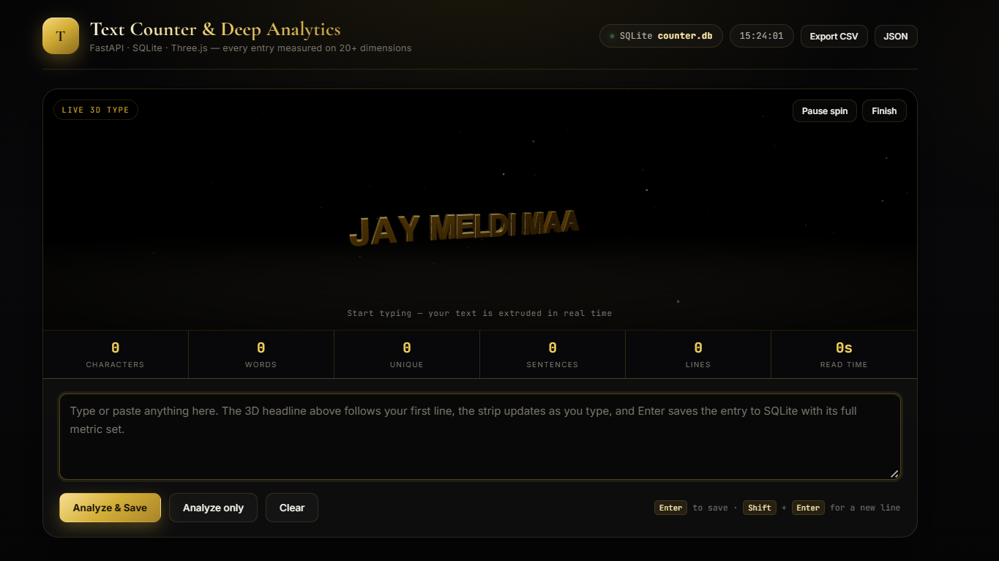
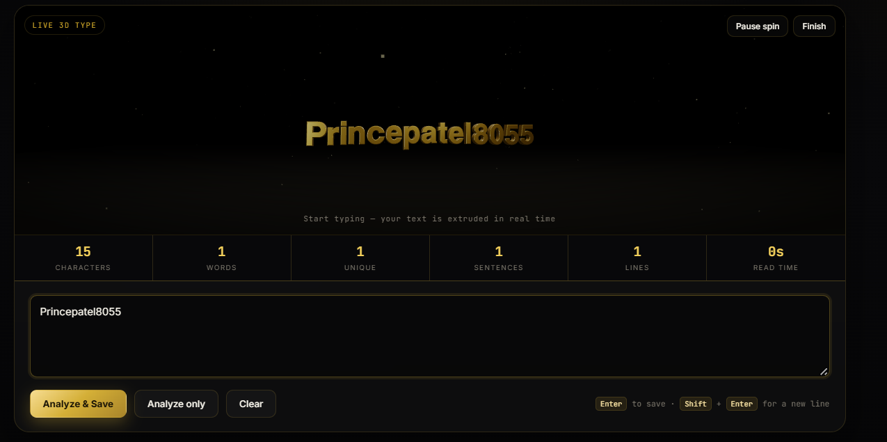
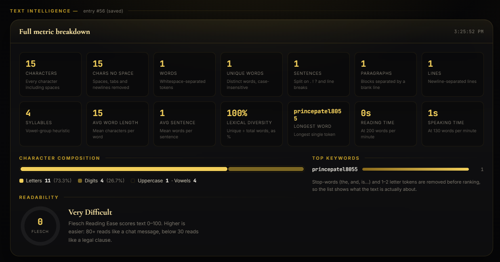
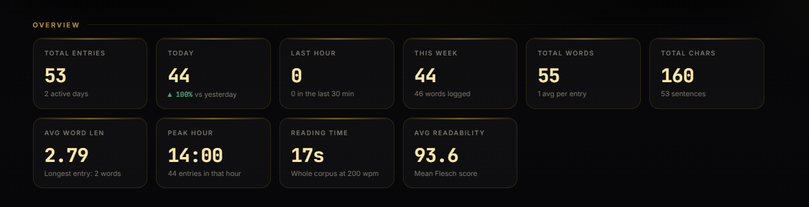
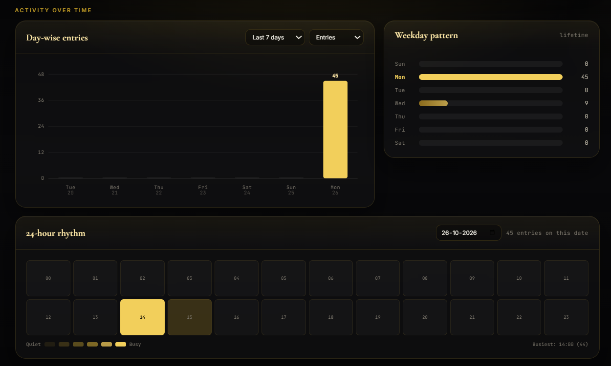
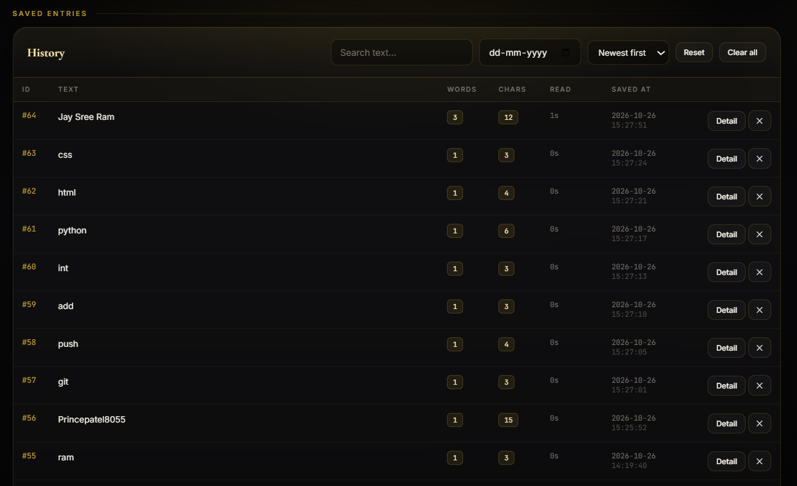

# 🔤 3D Text Counter & Deep Text Analytics

[](https://www.python.org/)
[](https://fastapi.tiangolo.com/)
[](https://www.sqlite.org/)
[](https://threejs.org/)
[-red?logo=adobeacrobatreader&logoColor=white)](docs/Project_Documentation.pdf)
[-orange?logo=microsoftpowerpoint&logoColor=white)](docs/Project_Presentation.pptx)
[](LICENSE)

**A local-first text analytics dashboard.** Type or paste text and watch it turn into real, extruded 3D metallic type — while the app measures 20+ linguistic metrics, saves every entry to SQLite, and charts your writing activity by day, weekday and hour.

No accounts. No cloud. Your text never leaves your computer.

[📄 Read Full Technical Specification (PDF)](docs/Project_Documentation.pdf) • [📊 View Presentation Deck (PPTX)](docs/Project_Presentation.pptx) • [🚀 Quick Start](#-getting-started)

<p align="center">
  
</p>

---

## 📚 Project Documentation & Presentation Deck

For academic reviews, portfolio showcases, technical deep-dives, or presentation meetings, full formal artifacts are provided:

| Document | Format | Description |
|---|---|---|
| [**Technical Specification & Project Report**](docs/Project_Documentation.pdf) | `PDF` (9 Pages) | Comprehensive engineering documentation: mathematical formulas (Flesch, syllable heuristics), database schema, 3D WebGL mesh architecture, REST API catalog, and security analysis. Built natively with ReportLab. *(Viewable directly in GitHub!)* |
| [**Project Presentation Deck**](docs/Project_Presentation.pptx) | `PPTX` (10 Slides) | 16:9 widescreen presentation deck with dark luxury aesthetic, cards, metrics, architecture diagrams, and high-res screenshots. Ready for college viva, hackathon pitches, or interviews. |

---

## 📸 Screenshots

### Live 3D typing
Every letter is real extruded geometry, and the headline follows what you type.

<p align="center">
  
</p>

### Full metric breakdown
20+ linguistic measurements per entry: counts, composition, readability, reading/speaking time and top keywords.

<p align="center">
  
</p>

### Overview KPIs
Total entries, today vs yesterday, peak hour, average readability and more at a glance.

<p align="center">
  
</p>

### Activity over time
Day-wise chart, weekday pattern and a 24-hour rhythm heatmap.

<p align="center">
  
</p>

### Searchable history
Search, filter by date, sort, open details, delete, and export to CSV or JSON.

<p align="center">
  
</p>

---

## ✨ Features

### 📝 Deep Text Analysis
- **Counts:** characters (with/without spaces), words, unique words, sentences, lines, paragraphs, syllables
- **Composition:** letters, digits, spaces, punctuation, uppercase, lowercase, vowels, consonants, emoji
- **Derived metrics:** average word and sentence length, lexical diversity, longest/shortest word
- **Reading time** (200 wpm) and **speaking time** (130 wpm)
- **Flesch Reading Ease** with a readability band (Very Easy → Very Difficult)
- **Keywords** extracted after removing English stop-words
- Analysis runs **live as you type**, and again when you save

### 🎨 Real 3D Typography
- Every letter is its own extruded, bevelled `TextGeometry` mesh — not a CSS trick
- **Incremental animation:** new letters drop in, removed letters spin and fade, unchanged letters keep running — typing feels continuous
- Studio **environment map** + warm key, cool rim and front-fill lights for convincing metal
- Four finishes: **Polished Gold, Brushed Brass, Champagne, Antique Bronze**
- Pause/resume spin with smooth easing
- Graceful fallback to extruded slabs if the typeface fails to load, and the dashboard still works without WebGL

### 📊 Writing Analytics Dashboard
- Entries per day (zero-filled so the timeline never breaks)
- 24-hour heatmap for any chosen date
- Lifetime weekday distribution
- Peak hour, peak day, active-day count, today vs yesterday change
- Corpus-wide keyword ranking

### 💾 Data Management
- Search, sort (newest / oldest / longest / most words) and filter by date
- View or delete single entries, or wipe everything with explicit confirmation
- **Export to CSV or JSON**
- Self-migrating database: old `counter.db` files upgrade in place with no data loss

---

## 🏗️ Architecture

```
┌──────────────┐    ┌──────────────┐    ┌──────────────┐
│  index.html  │───▶│    app.py    │───▶│ database.py  │
│  UI + 3D     │◀───│  FastAPI     │◀───│  SQLite      │
└──────────────┘    └──────┬───────┘    └──────────────┘
                           │
                    ┌──────▼───────┐
                    │ analytics.py │  pure text metrics
                    └──────────────┘
```

`analytics.py` has no database or web dependencies, so it is easy to unit-test and reuse on its own.

## 🛠️ Tech Stack

| Technology | Purpose |
|---|---|
| Python 3.10+ | Core logic and text analysis |
| FastAPI + Uvicorn | Backend API and server |
| Pydantic | Request validation |
| SQLite | Local persistent storage |
| HTML / CSS / JavaScript | Frontend (single-file UI) |
| Three.js | 3D typography |

## 📁 Project Structure

```text
python-text-counter/
├── app.py              # FastAPI routes, export endpoints, launcher (free-port detection + browser open)
├── analytics.py        # Pure text-analysis engine
├── database.py         # SQLite schema, migration, aggregation queries
├── requirements.txt    # Python dependencies
├── run.bat             # Windows one-click launcher
├── run.sh              # macOS/Linux launcher
├── LICENSE             # MIT Open Source License
├── README.md
├── docs/
│   ├── Project_Documentation.pdf   # 9-page technical specification & report
│   ├── Project_Presentation.pptx   # 10-slide 16:9 presentation deck
│   └── *.png                       # Dashboard screenshots
├── templates/
│   └── index.html      # Dashboard UI, Three.js stage, charts
└── static/
    └── vendor/         # Local frontend assets
```

`counter.db` is created automatically on first run.

---

## 🚀 Getting Started

### Prerequisites
- Python 3.10 or later
- Git (to clone the repo)
- Internet on the first load, for the Three.js library and typeface (unless you have bundled them in `static/vendor/`). Everything else works offline.

### 1. Clone
```bash
git clone https://github.com/prinspatel8055/python-text-counter.git
cd python-text-counter
```

### 2. Create a virtual environment (recommended)

**Windows**
```powershell
python -m venv .venv
.venv\Scripts\activate
```

**macOS / Linux**
```bash
python3 -m venv .venv
source .venv/bin/activate
```

### 3. Install dependencies
```bash
python -m pip install -r requirements.txt
```

### 4. Run

| Platform | Command |
|---|---|
| Windows | Double-click `run.bat` (or run `.\run.bat`) |
| macOS / Linux | `chmod +x run.sh && ./run.sh` |
| Any | `python app.py` |

The server uses port **8000** if it is free, otherwise any free port, and opens `http://127.0.0.1:<port>` in your browser. If the browser doesn't open, check the terminal for the URL. Press `Ctrl+C` to stop.

Interactive API docs live at **`/docs`**.

---

## 📐 How the metrics are defined

| Metric | Definition |
|---|---|
| Average word length | Mean characters per word |
| Average sentence length | Mean words per sentence |
| Lexical diversity | Unique ÷ total words, as a percentage |
| Reading time | Words ÷ 200 per minute |
| Speaking time | Words ÷ 130 per minute |
| Flesch Reading Ease | `206.835 − 1.015 × (words/sentence) − 84.6 × (syllables/word)`, clamped 0–100 |
| Readability band | Very Easy (80+), Easy (60+), Fairly Hard (50+), Difficult (30+), Very Difficult |
| Keywords | Most frequent words after removing a 130-word English stop-list and tokens under 3 characters |

---

## 🔌 API Reference

| Method | Path | Purpose |
|---|---|---|
| `GET` | `/` | The dashboard |
| `GET` | `/api/health` | Version and DB status |
| `POST` | `/api/analyze` | Full metrics for a text **without saving** |
| `POST` | `/api/texts` | Analyze + save; returns the stored entry |
| `GET` | `/api/texts` | List entries: `limit`, `search`, `date`, `sort=newest\|oldest\|longest\|words` |
| `GET` | `/api/texts/{id}` | One entry with recomputed metrics and keywords |
| `DELETE` | `/api/texts/{id}` | Delete one entry |
| `DELETE` | `/api/texts?confirm=true` | Delete every entry |
| `GET` | `/api/stats` | Summary KPIs |
| `GET` | `/api/stats/daywise?days=7` | Day-by-day series (1–90 days) |
| `GET` | `/api/stats/hourly?date=YYYY-MM-DD` | 24-slot breakdown |
| `GET` | `/api/stats/weekday` | Lifetime weekday distribution |
| `GET` | `/api/stats/keywords?limit=15` | Corpus-wide keywords |
| `GET` | `/api/stats/overview?days=7` | All of the above in one round-trip |
| `GET` | `/api/export?format=csv\|json` | Download the full table |

**Example**
```bash
curl -X POST http://127.0.0.1:8000/api/analyze \
  -H "Content-Type: application/json" \
  -d '{"text":"The quick brown fox jumps over the lazy dog."}'
```

---

## ⌨️ Keyboard Shortcuts

| Shortcut | Action |
|---|---|
| `Enter` | Analyze and save the entry |
| `Shift` + `Enter` | Insert a line break |

## 🎛️ Customizing

- **Default headline:** when the input is empty, the 3D stage shows `JAY MELDI MAA`. Change `DEFAULT_TEXT` near the top of the stage code in `templates/index.html` to use your own.
- The headline follows the first line of your input, truncates at a word boundary around 20 characters, and skips characters the Latin typeface cannot draw.

---

## 🔒 Privacy & Security

- Everything runs on `127.0.0.1`; text is stored only in a local SQLite file.
- There is **no authentication**. This is a personal tool, so do not expose it to a network without adding auth.
- Don't commit your `counter.db` or private text to a public repository (add `counter.db` to `.gitignore`).

## ⚠️ Known Limitations

- Syllable counting is a vowel-group heuristic, so Flesch scores are indicative, good for comparing your own entries but not for formal certification.
- Sentence splitting is regex-based and treats `Dr.` or `e.g.` as a sentence break.
- The stop-word list is English only; other languages will surface common function words as keywords.
- The 3D stage needs WebGL and its CDN assets; without them the rest of the dashboard still works.

## 🗺️ Roadmap

- [ ] Unit and integration tests for `analytics.py`
- [ ] Language-aware analysis and stop-words
- [ ] Mobile-friendly layout and accessibility improvements
- [ ] More export formats and reports
- [ ] Optional user accounts for multi-user deployments

## 🤝 Contributing

Issues and pull requests are welcome. Found a bug or have an idea? [Open an issue](https://github.com/prinspatel8055/python-text-counter/issues).

## 📄 License

This project is licensed under the [MIT License](LICENSE) - see the [LICENSE](LICENSE) file for full details.

## 👨‍💻 Author & Maintainer

**Prince Patel** — [@prinspatel8055](https://github.com/prinspatel8055)

---

<div align="center">

### ⭐ Support This Project

If you found **3D Text Counter & Deep Text Analytics** useful, intuitive, or visually inspiring, please give it a star on GitHub!  
It costs nothing and helps fellow developers, linguists, and researchers discover this local-first tool.

[](https://github.com/prinspatel8055/python-text-counter)

</div>
